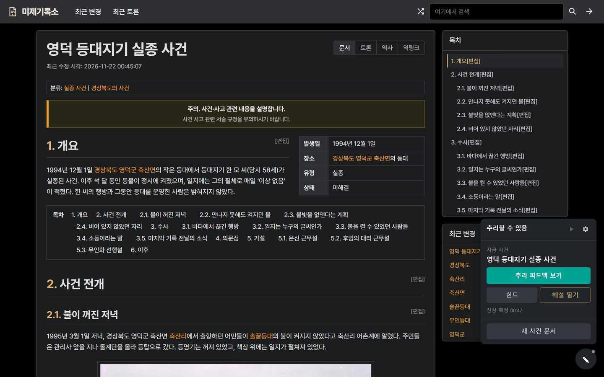
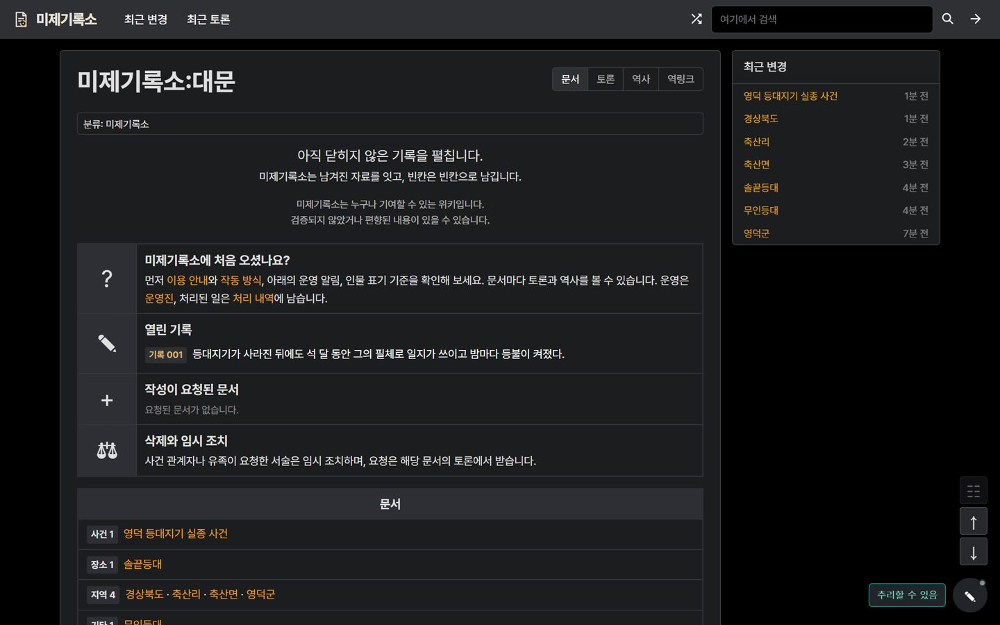
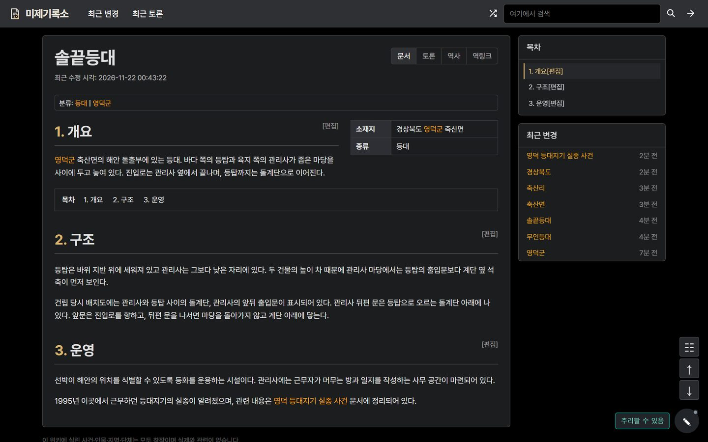
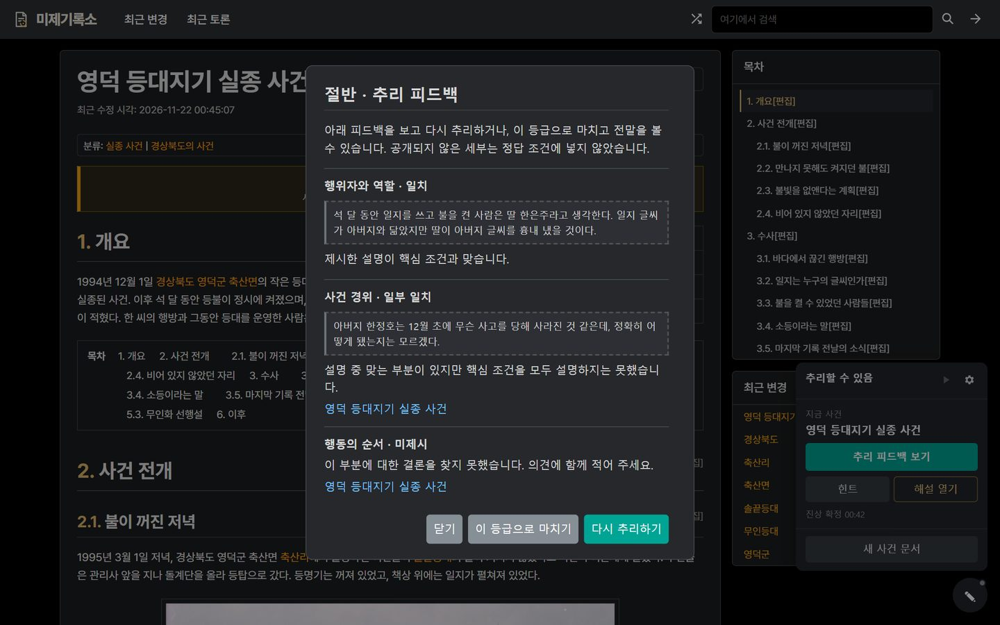
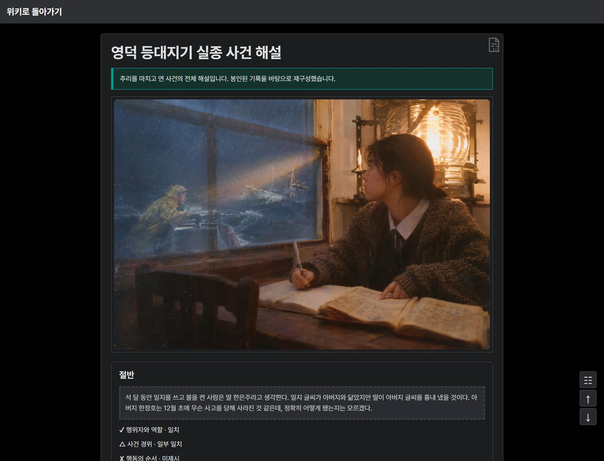
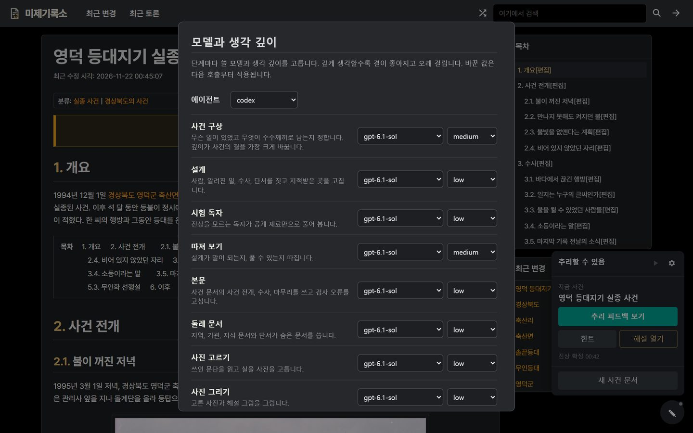
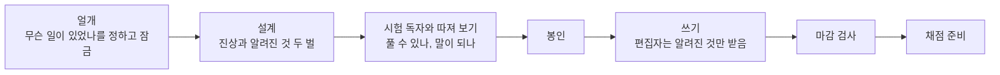

# 라이브 미스터리 위키

AI가 미제 사건을 짓고, 나무위키 같은 사건 문서로 실시간으로 써 나가는 위키입니다. 보는 사람은 답을 모르는 채로 문서가 자라는 것을 읽고, 링크를 타고 흩어진 단서를 모아 무슨 일이 있었는지 추리합니다. 추리를 내면 채점을 받고, 맞히면 사건의 전말이 열립니다.



- **진짜로 아무도 답을 모릅니다.** 문서를 쓰는 편집자 에이전트도 진상을 모릅니다. 진상은 따로 지어 봉인하고, 편집자는 세상에 알려진 것만 받아 문서를 씁니다.
- **눈앞에서 자랍니다.** 개요가 먼저 뜨고, 사건 전개, 수사, 의문점, 토론, 사진이 몇 분에 걸쳐 차례로 붙습니다.
- **단서는 흩어져 있습니다.** 사건 문서만 읽어서는 풀리지 않습니다. 인물, 장소, 기관 문서와 검색 속에 단서가 숨어 있습니다.
- **방송용으로 만들었습니다.** 진행자와 시청자가 함께 위키 화면을 띄워 놓고 같이 추리하는 것을 생각하고 만들었습니다.

## 화면 둘러보기

| | |
|---|---|
|  |  |
| **대문.** 위키를 열 때마다 새 시즌이 시작되고, 에이전트가 로고와 상징색, 인사말, 운영진을 정합니다. | **둘레 문서.** 사건과 상관없어 보이는 문서의 한 줄이 단서일 수 있습니다. |
|  |  |
| **추리 제출.** 무슨 일이 있었는지와 근거를 적어 내면, 미리 정해 둔 기준마다 맞힘·일부·놓침을 짚고 등급을 매깁니다. | **사건의 전말.** 맞히거나 등급으로 마치면, 아무도 보지 못한 순간을 그린 그림과 내 추리의 판정, 진상과 단서의 뜻이 나옵니다. |



## 시작하기

**필요한 것**
- 아래 앱 가운데 하나. 로그인되어 있으면 따로 CLI를 설치하거나 다시 로그인할 필요가 없습니다.
  - **Claude 데스크톱 앱**의 Code 탭
  - **Codex 앱**(ChatGPT 데스크톱의 Codex)
  - 또는 터미널용 [Claude Code](https://claude.com/claude-code)나 [Codex CLI](https://github.com/openai/codex)
- 파이썬 3.10 이상. 다른 설치는 없습니다. 파이썬 표준 라이브러리만 씁니다. 없으면 에이전트에게 설치를 부탁하면 됩니다.
- 사건을 쓰는 데 드는 사용량은 본인 구독에서 나갑니다. 사진까지 그리려면 Codex가 필요합니다. Claude로 돌리면 사진 없이 글만 쓰입니다.

**설치와 첫 실행: 앱에 말로 하면 됩니다**

Claude 데스크톱 앱의 Code 탭이나 Codex 앱에서 이렇게 말합니다.

> https://github.com/INGKKUKKU/mystery-wiki-skill 스킬을 설치하고, 미스터리 위키 하나 만들어 줘.

에이전트가 할 일은 이렇습니다.
1. 저장소를 스킬 폴더에 받습니다. Claude는 `~/.claude/skills/mystery-wiki`, Codex는 `~/.codex/skills/mystery-wiki`예요.
2. 위키 이름과 저장할 폴더를 묻고 위키를 만듭니다.
3. 뒤에서 사건을 쓸 에이전트를 찾고 연결을 시험합니다. 지금 대화하는 앱 쪽을 먼저 씁니다.
4. 브라우저에 위키를 띄웁니다.

그다음부터는 브라우저에서만 합니다. 다시 켤 때는 위키 폴더의 `live.bat`을 누르거나 `python tools/live.py`를 실행합니다.

직접 받으려면 이렇게 합니다.

```bash
git clone https://github.com/INGKKUKKU/mystery-wiki-skill ~/.claude/skills/mystery-wiki   # Claude
git clone https://github.com/INGKKUKKU/mystery-wiki-skill ~/.codex/skills/mystery-wiki    # Codex
```

**뒤에서 사건을 쓰는 에이전트를 찾는 차례**

위키 서버는 사건을 쓸 때마다 에이전트 CLI를 대화창 없이 부릅니다. CLI는 이 차례로 찾습니다.
1. Codex 앱 안에서 켰으면 앱이 쓰는 codex
2. 터미널용으로 설치해 PATH에 있는 `claude`나 `codex` (예전과 같습니다)
3. 데스크톱 앱이 깔아 둔 CLI
   - Claude 데스크톱 앱: Code 탭을 한 번 쓰면 받아 둡니다.
   - Codex 앱: 앱 안에 codex가 들어 있습니다.

어디서 찾았는지와 로그인 상태는 위키 폴더에서 `python tools/live.py --check`로 봅니다. 로그인이 필요하면 무엇을 실행해야 하는지 알려 줍니다. 로그인은 CLI 자신의 것을 쓰고, 앱의 대화 세션을 빌려 쓰지 않습니다.
- **Codex:** 앱과 CLI가 같은 로그인(`~/.codex`)을 써서 보통 바로 됩니다.
- **Claude:** 앱의 로그인이 CLI에 넘어가지 않는 경우가 있습니다. 그러면 안내대로 `claude auth login`을 한 번 실행해 브라우저에서 로그인합니다.
- **Codex 버전:** `--ignore-user-config`를 지원하는 판이어야 합니다. 뒤에서 실행할 때 외부 도구 연결을 끄며, 평소 쓰는 Codex 설정은 건드리지 않습니다.

## 쓰는 법

화면 오른쪽 아래의 ✎ 단추를 누르면 조작부가 펼쳐집니다.

| 단추 | 하는 일 |
|---|---|
| 새 사건 문서 | 새 사건을 엽니다. 쓰고 싶은 사건을 한 줄로 적어도 되고, 비워 두면 에이전트가 알아서 짓습니다. 쓰는 중에 누르면 다음 사건으로 예약되고, 앞 사건이 끝나면 순서대로 열립니다. |
| 추리 제출 | 무슨 일이 있었는지와 근거를 적어 냅니다. 결과는 완전 해결, 거의 해결, 절반, 빗나감 네 등급이고, 완전 해결이 아니면 다시 내거나 그 등급으로 마치고 전말을 볼 수 있습니다. |
| 힌트 | 막혔을 때 사건마다 세 번까지, 위키에 새 소식이 올라옵니다. 뒤로 갈수록 진상에 가깝습니다. |
| 해설 열기 | 맞히지 않고 전말을 엽니다. 연 뒤에는 그 사건에 추리를 낼 수 없습니다. |
| 추리 기록 | 사건마다 낸 추리와 등급, 쓴 힌트를 모아 봅니다. 맨 위에 등급별 성적 표가 있고, 추리한 사건이 가장 크게, 손대지 않은 사건은 이름만 나옵니다. |
| ⏸ / ▶ | 쓰는 것을 잠깐 멈추거나 이어 씁니다. |
| ⚙ | 단계마다 쓸 모델과 생각 깊이를 고릅니다. 위키를 띄운 컴퓨터에서만 보입니다. |

문서마다 있는 **토론** 탭에 글을 남기면 편집자들이 답하고, 빠진 사실이면 문서를 보강합니다.

## 작동 방식



- **두 벌의 기록.** 작가 에이전트는 사건을 진상과 알려진 것 두 벌로 짓습니다. 문서를 쓰는 편집자는 알려진 것만 받습니다. 답을 아는 채로 숨기며 쓰면 문장마다 티가 나기 때문입니다.
- **봉인.** 진상은 쓰기 전에 잠그고 지문을 떠 둡니다. 추리가 들어온 뒤에 답을 바꿀 수 없습니다.
- **채점.** 기준은 추리를 보기 전에 봉인된 진상에서 만듭니다. 에이전트는 기준마다 맞힘·일부·놓침만 판정하고, 등급은 서버가 정해진 표로 계산합니다. 같은 추리에 점수가 흔들리지 않게 하려고 숫자를 에이전트에게 맡기지 않습니다.
- **사진.** 문단이 쓰이면 사진 담당이 그 글만 읽고 실을 사진을 고르고, 그 시절에 찍혔을 법한 사진으로 그립니다. 이름을 가리는 사람의 얼굴은 서버가 모자이크합니다.
- **닮은 사건 막기.** 사건마다 "알고 보니 어떤 일이었나"를 한 줄로 남겨, 다음 사건이 속사정까지 겹치지 않게 합니다. 사건을 구상하는 단계에는 이 한 줄과 때만 짧게 보여 줘서, 사건이 쌓여도 첫 화면이 느려지지 않습니다.

## 설정과 시간

조작부의 ⚙에서 단계마다 모델과 생각 깊이를 고릅니다. 깊이가 사건을 가장 크게 바꾸는 단계는 **사건 구상**입니다.

| 사건 구상 깊이 | 첫 화면까지 | 사건 하나 | 결 |
|---|---|---|---|
| low | 약 1분 반 | 7~8분 | 따뜻한 사연이나 조작된 퍼즐로 기움 |
| medium (기본) | 3~5분 | 8~10분 | 결이 고루 나옴 |
| high | 약 8~12분 | 약 15분 | 가장 기묘하지만 느림 |

Codex gpt-6.1-sol로 재어 본 값입니다. 모델을 고르지 않으면 Codex의 기본 모델 설정과 상관없이 gpt-6.1-sol을 씁니다. 쓰고 싶은 사건을 직접 적어 주면 무엇을 쓸지가 이미 정해져 있으므로 사건 구상을 low로 두어도 충분합니다. 방송에서는 이쪽을 권합니다.

## 주의할 것

- **방송이나 화면 공유에는 브라우저의 위키만 내보냅니다.** 위키 폴더의 `plan/`, `admin/`, `.live/`와 에이전트 대화창에는 진상이 그대로 보입니다.
- **실린 사건과 인물은 모두 창작입니다.** 위키를 처음 열 때 뜨는 안내, 모든 쪽 아래의 고지, 검색 엔진 수집 차단으로 이를 밝힙니다. 이 표시들은 지우지 않습니다.
- 주문 없이 지을 때는 실제 사건을 본뜨지 않습니다.
- 위키를 남에게 보낼 때는 `site/` 폴더나 `python tools/build.py --single`로 만든 한 파일(`dist/`)만 내보냅니다. 위키 폴더를 통째로 올리면 진상이 공개됩니다.

## 폴더

```
mystery-wiki/
├── SKILL.md          에이전트가 읽는 사용 설명
├── assets/tools/     위키에 복사되는 프로그램 (라이브 서버, 엔진, 에이전트 찾기, 검사, 채점)
├── assets/templates/ 문서 양식
├── references/       사진 만들기, 채점, 추리 검토 지침
└── scripts/          위키 만들기(new_wiki.py)와 테스트
```

테스트는 `scripts/` 폴더에서 `python -X utf8 test_fast.py`처럼 하나씩 돌립니다. 에이전트를 실제로 부르지 않습니다.

## 라이선스

[MIT](LICENSE)
